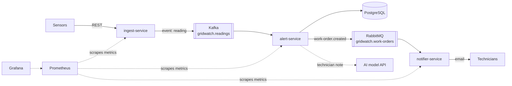

# GridWatch

Monitoring and maintenance for electricity substations.

Sensors in substations continuously send temperature and load readings. GridWatch stores every reading, detects values above the safe limit, opens a **maintenance work order** and notifies the field technicians, with a short note drafted by an AI model. The system is event-driven, observable and runs in containers on Kubernetes.

> Background: the author built a maintenance platform for 180 high-voltage substations at a regional electric utility. GridWatch rebuilds that domain with a modern, cloud-native Java stack.

## What it does

1. A sensor sends a reading (substation, sensor type, value, time) to the **ingest-service**.
2. ingest-service validates it, gives it a unique id and publishes it as an event to **Kafka**.
3. **alert-service** consumes the event, ignores duplicates, stores the reading in **PostgreSQL** and compares the value with the limit for that sensor type.
4. Above the limit, alert-service opens a work order and puts a notification task on **RabbitMQ**; an AI model drafts a note for the technician.
5. **notifier-service** picks up the task and notifies the technician team, retrying on failure.
6. **Prometheus** collects metrics from all services and **Grafana** shows them on a dashboard.

| Sensor type | Work order when value is |
|---|---|
| `TEMPERATURE` | above 90 |
| `LOAD` | above 100 |

## Architecture



The full C4 model (context, containers, components, code), the reading flow and the design decisions are in **[docs/ARCHITECTURE.md](docs/ARCHITECTURE.md)**.

## Tech stack

| Area | Technologies |
|---|---|
| Language and framework | Java 21, Spring Boot 4 (MVC, Security, Data JPA, Validation, Actuator) |
| Messaging | Apache Kafka (KRaft) for the reading stream, RabbitMQ for notification tasks |
| Data | PostgreSQL, Hibernate, Flyway migrations |
| Resilience | Idempotent consumers, dead-letter topic and queue, Resilience4j circuit breaker |
| AI | Spring AI (technician notes) |
| Testing | JUnit 5, Mockito, Testcontainers |
| Delivery | Docker, Docker Compose, GitHub Actions CI |
| Runtime | Kubernetes (kind locally) with Helm, AWS |
| Observability | Micrometer, Prometheus, Grafana |

## Services

| Service | Responsibility | Main interfaces |
|---|---|---|
| ingest-service | Public entry point: validate readings, assign a UUID, publish to Kafka | `POST /api/readings` → `202 Accepted` with the reading id |
| alert-service | Consume readings, skip duplicates, store, apply limits, create work orders | Kafka consumer, `GET /work-orders` |
| notifier-service | Email the technician team once per work order, with retries and a dead-letter queue | RabbitMQ consumer, SMTP |

All services expose `GET /actuator/health` (no login) and metrics for Prometheus. Other endpoints use HTTP Basic authentication.

## Run it

Requirements: Docker. (Java 21 only to run the services from an IDE.)

```bash
docker compose up -d --build
```

| What | Where |
|---|---|
| Send readings | http://localhost:8082/api/readings |
| Work orders | http://localhost:8081/work-orders |
| RabbitMQ dashboard | http://localhost:15672 |
| Test email inbox (Mailpit) | http://localhost:8025 |

The `notifier` database is created once: `docker compose exec db psql -U gridwatch -d gridwatch -c "create database notifier;"`

Send a reading (credentials are set in the service configuration):

```bash
curl -u <user>:<password> -H "Content-Type: application/json" \
  -d '{"substationId":"DEV-01","sensorType":"TEMPERATURE","value":95.5,"measuredAt":"2026-10-16T09:30:00Z"}' \
  http://localhost:8082/api/readings
```

## Project structure

```
gridwatch/
├── ingest-service/       Spring Boot: entry point, validation, Kafka producer
├── alert-service/        Spring Boot: Kafka consumer, limit rule, work orders, PostgreSQL
├── notifier-service/     Spring Boot: RabbitMQ consumer, technician notifications
├── monitoring/           Prometheus and Grafana configuration
├── helm/                 Kubernetes deployment
├── docs/                 Architecture (C4) and design decisions
└── docker-compose.yml    Full local stack
```

## Key design decisions

- **Kafka between ingest and alert**: readings survive when alert-service is down, and new consumers need no change to ingest-service.
- **Message key = substation id**: readings of one substation stay in order.
- **UUID per reading, created at ingest**: alert-service detects duplicates (Kafka delivers at least once).
- **RabbitMQ for notifications**: one-time tasks with per-message retries and a dead-letter queue.
- **Publish after commit, notify once**: alert sends only committed work orders; notifier records each work order id so a redelivered message sends no second email.
- **`Instant` with `timestamp with time zone`**: no daylight-saving or time-zone bugs.
- **Each service owns its data**: no shared database.

Details and alternatives: [docs/ARCHITECTURE.md](docs/ARCHITECTURE.md).

## Documentation

- [Architecture (C4)](docs/ARCHITECTURE.md)
- [Docker basics](docs/docker-basics.md)
- [Kafka basics](docs/kafka-basics.md)
- [Kafka and the services in Docker](docs/kafka-in-docker.md)
- [RabbitMQ basics](docs/rabbitmq-basics.md)
- [Messaging flow: Kafka to RabbitMQ](docs/messaging-flow.md)
- [Kafka cheat sheet](docs/kafka-cheatsheet.md)
- [RabbitMQ cheat sheet](docs/rabbitmq-cheatsheet.md)
- [Week 0: setup and project structure](docs/weeks/week-00-setup.md)
- [Week 1: REST services](docs/weeks/week-01-rest-services.md)
- [Week 2: Kafka](docs/weeks/week-02-kafka.md)
- [Week 3: RabbitMQ and notifier-service](docs/weeks/week-03-rabbitmq.md)
