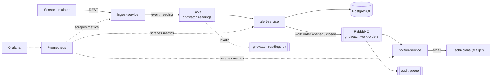

# GridWatch

Monitoring and maintenance for electricity substations.

Sensors in substations continuously send temperature and load readings. GridWatch stores every reading, detects values above the safe limit, opens a **maintenance work order** and emails the field technicians. The system is event-driven, tested against real infrastructure and runs fully in Docker.

> Background: the author built a maintenance platform for 180 high-voltage substations at a regional electric utility. GridWatch explores how that domain can be built today with an event-driven Java stack.

> **Status: work in progress.** Everything under "What works today" is implemented and tested. Features under "Roadmap" are planned and not in the code yet.

## What works today

- Three Spring Boot services: ingest, alert and notifier
- Readings stream through **Kafka**; work order events go through **RabbitMQ**
- Work orders stored in **PostgreSQL**, schema managed with **Flyway**
- Work orders can be closed; technicians get an email when a work order opens and when it closes
- Idempotent consumers: duplicate readings and duplicate notifications are skipped
- Dead-letter topic (Kafka) for invalid readings, dead-letter queues (RabbitMQ) for failed messages
- Audit queue that receives a copy of every work order event
- 34 unit and integration tests (JUnit 5, Mockito, Testcontainers with real PostgreSQL, Kafka and RabbitMQ)
- GitHub Actions: tests every service and builds its Docker image on every push
- Metrics with Micrometer, collected by **Prometheus** and shown on a **Grafana** dashboard
- Sensor simulator that sends a steady stream of readings
- One command starts everything: `docker compose up`

## Roadmap

| Planned | Why |
|---|---|
| Kubernetes (kind) with a Helm chart, 2 alert-service replicas | Show that alerts keep working when one pod dies |
| One cloud deployment (AWS, later Azure) | Run the system outside a laptop |
| AI-drafted technician note behind a Resilience4j circuit breaker | Alerts must still arrive when the AI is down |
| Notes grounded in maintenance manuals (RAG with pgvector) and an evaluation set | Notes must quote a real manual section, measured, not guessed |
| Demo GIF in this README | See the whole flow in 30 seconds |

## How it works

1. A sensor sends a reading (substation, sensor type, value, time) to the **ingest-service**.
2. ingest-service validates it, gives it a unique id and publishes it as an event to **Kafka**.
3. **alert-service** consumes the event, ignores duplicates, stores the reading in **PostgreSQL** and compares the value with the limit for that sensor type.
4. Above the limit, alert-service opens a work order and publishes a work order event to **RabbitMQ**.
5. **notifier-service** picks up the event and emails the technician team once per work order, retrying on failure.
6. **Prometheus** collects metrics from all services and **Grafana** shows them on a dashboard.

| Sensor type | Work order when value is |
|---|---|
| `TEMPERATURE` | above 90 |
| `LOAD` | above 100 |

## Architecture (current)



The C4 model, the reading flow and more design detail are in **[docs/ARCHITECTURE.md](docs/ARCHITECTURE.md)**.

## Tech stack

| Area | Technologies |
|---|---|
| Language and framework | Java 21, Spring Boot 4 (MVC, Security, Data JPA, Validation, Actuator) |
| Messaging | Apache Kafka (KRaft) for the reading stream, RabbitMQ for work order events |
| Data | PostgreSQL, Hibernate, Flyway migrations |
| Reliability | Idempotent consumers, dead-letter topic and queues, retries |
| Testing | JUnit 5, Mockito, Testcontainers |
| Delivery | Docker, Docker Compose, GitHub Actions CI |
| Observability | Micrometer, Prometheus, Grafana |

## Services

| Service | Responsibility | Main interfaces |
|---|---|---|
| ingest-service | Public entry point: validate readings, assign a UUID, publish to Kafka | `POST /api/readings` → `202 Accepted` with the reading id |
| alert-service | Consume readings, skip duplicates, store, apply limits, open and close work orders | Kafka consumer, `GET /work-orders`, `POST /work-orders/{id}/close` |
| notifier-service | Email the technician team once per work order event, with retries and a dead-letter queue | RabbitMQ consumer, SMTP |
| sensor-simulator | Send realistic readings to ingest-service | Optional, `docker compose --profile simulator up` |

All services expose `GET /actuator/health` (no login) and metrics for Prometheus. Other endpoints use HTTP Basic authentication.

## Run it

Requirements: Docker. (Java 21 only to run the services from an IDE.)

```bash
cp .env.example .env        # then fill in your own passwords
docker compose up -d --build
```

| What | Where |
|---|---|
| Send readings | http://localhost:8082/api/readings |
| Work orders | http://localhost:8081/work-orders |
| RabbitMQ dashboard | http://localhost:15672 |
| Test email inbox (Mailpit) | http://localhost:8025 |
| Prometheus | http://localhost:9090 |
| Grafana dashboard | http://localhost:3000 |

Send a reading (the user name is in the service configuration, the password in your `.env`):

```bash
curl -u <user>:<password> -H "Content-Type: application/json" \
  -d '{"substationId":"DEV-01","sensorType":"TEMPERATURE","value":95.5,"measuredAt":"2026-10-16T09:30:00Z"}' \
  http://localhost:8082/api/readings
```

A value of 95.5 is above the limit, so a work order appears at `/work-orders` and an email arrives in Mailpit.

## Testing

| Type | What it checks | Tools |
|---|---|---|
| Unit tests | Limit rules, duplicate handling, notification logic, one class at a time | JUnit 5, Mockito |
| Web layer tests | Routing, JSON, validation and error responses of the controllers | `@WebMvcTest`, MockMvc |
| Integration tests | The whole service against real brokers and a real database: send a message in, check the database and the outgoing message | Testcontainers (PostgreSQL, Kafka, RabbitMQ) |

```bash
./mvnw verify        # run inside a service folder; Docker must be running
```

## Design decisions

- **Why Kafka for readings?** Readings are a stream of events. Kafka keeps them, so they survive when alert-service is down, and new consumers can read the same stream without any change to ingest-service.
- **Why RabbitMQ for work order events?** Each event is a task that must be done once: send an email. RabbitMQ gives per-message acknowledgement, retries and a dead-letter queue, and a topic exchange routes opened and closed work orders by routing key.
- **Message key = substation id:** readings of one substation stay in order.
- **UUID per reading, created at ingest:** Kafka delivers at least once, so alert-service uses the id to skip duplicates.
- **Publish after commit, notify once:** alert-service only publishes work orders that are saved; notifier-service records each work order event so a redelivered message sends no second email.
- **Why Testcontainers?** In-memory fakes behave differently from production. The integration tests run against the same PostgreSQL, Kafka and RabbitMQ the system uses.
- **Why Flyway?** Schema changes are versioned SQL files, reviewed like code and applied in the same order everywhere; Hibernate only validates.
- **`Instant` with `timestamp with time zone`:** no daylight-saving or time-zone bugs.
- **Each service owns its data:** no shared database.

## Project structure

```
gridwatch/
├── ingest-service/       Spring Boot: entry point, validation, Kafka producer
├── alert-service/        Spring Boot: Kafka consumer, limit rule, work orders, PostgreSQL
├── notifier-service/     Spring Boot: RabbitMQ consumer, technician emails
├── sensor-simulator/     Sends test readings to ingest-service
├── monitoring/           Prometheus and Grafana configuration
├── docs/                 Architecture (C4), cheat sheets, week-by-week notes
└── docker-compose.yml    Full local stack
```

## Documentation

- [Architecture (C4)](docs/ARCHITECTURE.md)
- [Docker basics](docs/docker-basics.md)
- [Kafka basics](docs/kafka-basics.md)
- [Kafka and the services in Docker](docs/kafka-in-docker.md)
- [RabbitMQ basics](docs/rabbitmq-basics.md)
- [Messaging flow: Kafka to RabbitMQ](docs/messaging-flow.md)
- [Kafka cheat sheet](docs/kafka-cheatsheet.md)
- [RabbitMQ cheat sheet](docs/rabbitmq-cheatsheet.md)
- [Testing cheat sheet](docs/testing-cheatsheet.md)
- [Monitoring cheat sheet](docs/monitoring-cheatsheet.md)
- [Week 0: setup and project structure](docs/weeks/week-00-setup.md)
- [Week 1: REST services](docs/weeks/week-01-rest-services.md)
- [Week 2: Kafka](docs/weeks/week-02-kafka.md)
- [Week 3: RabbitMQ and notifier-service](docs/weeks/week-03-rabbitmq.md)
- [Week 4: testing](docs/weeks/week-04-testing.md)
- [Week 5: CI and monitoring](docs/weeks/week-05-ci-monitoring.md)
