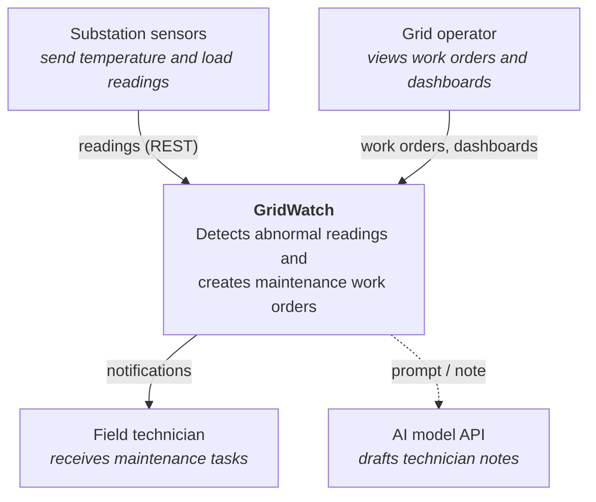
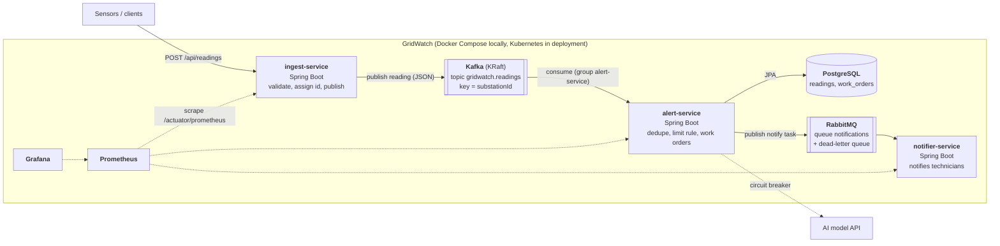
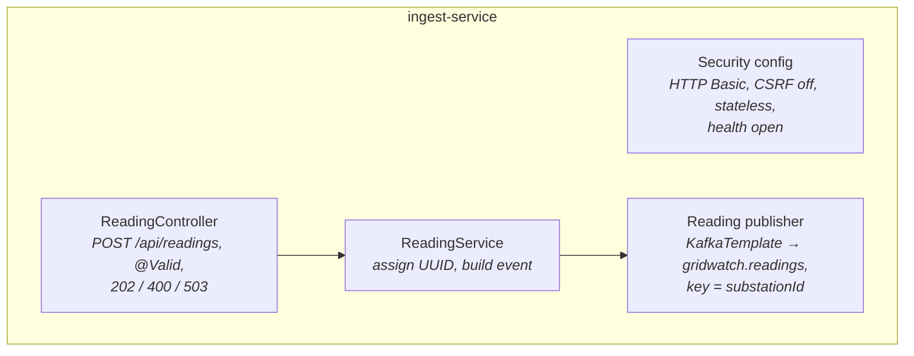
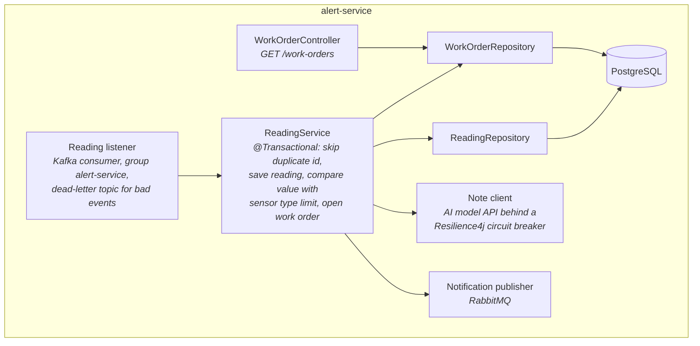
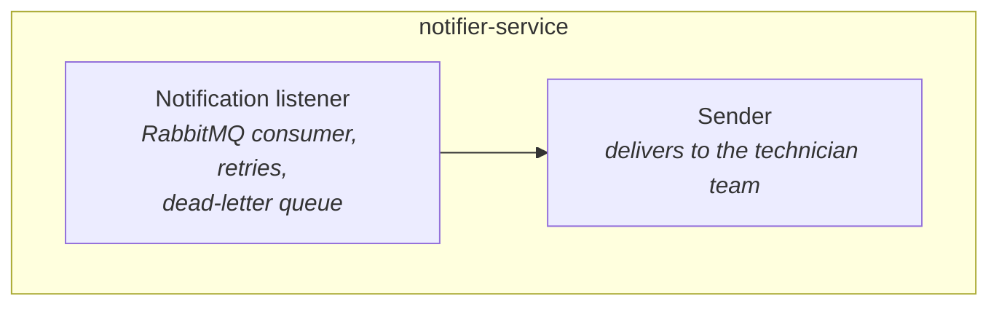
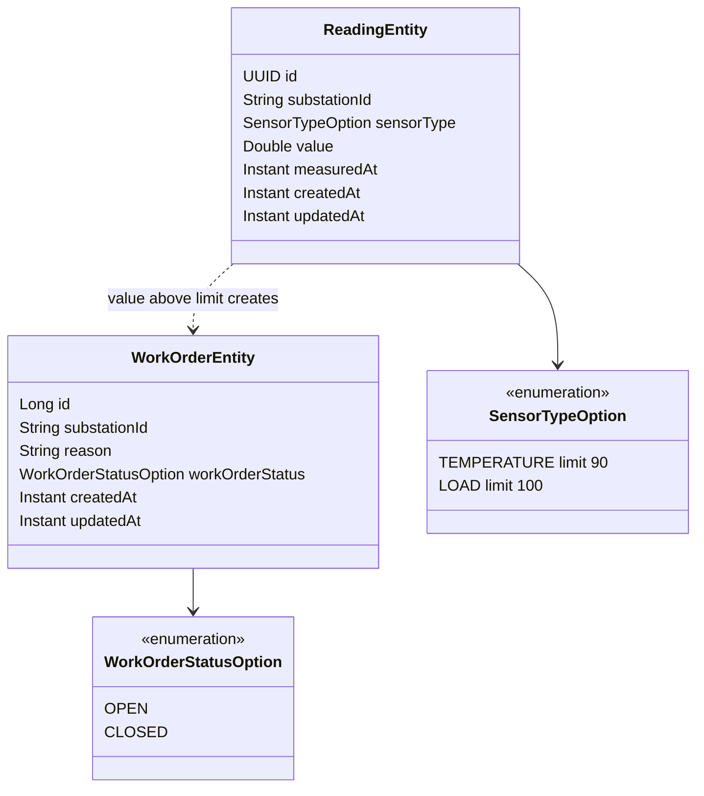
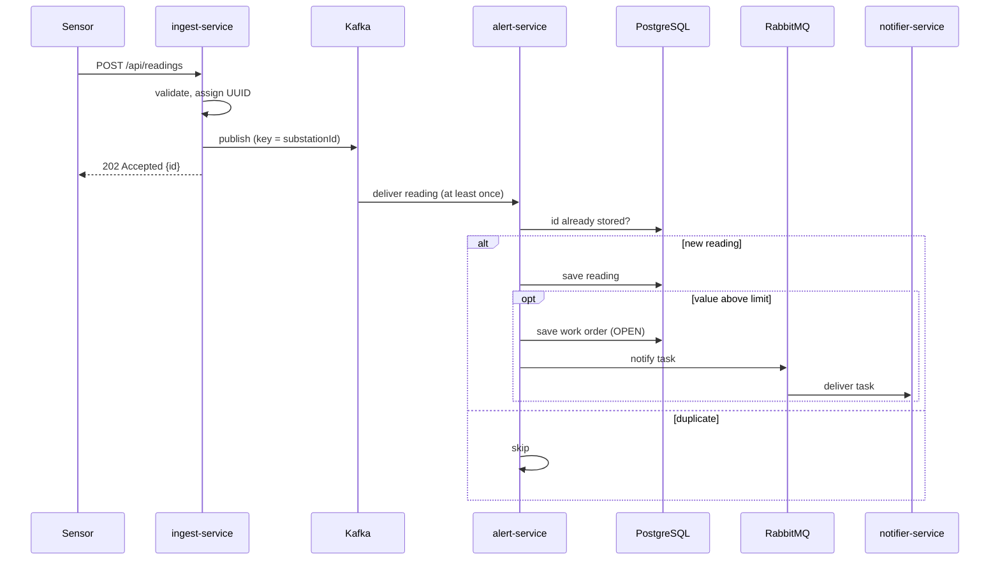
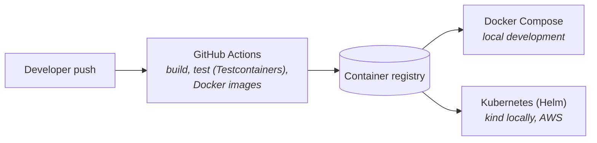

# GridWatch architecture

This document describes GridWatch with the **C4 model**: four zoom levels, from the big picture to the code.

| Level | Question it answers |
|---|---|
| 1. System context | Who uses GridWatch, and which outside systems does it touch? |
| 2. Containers | Which applications and data stores make up GridWatch, and how do they talk? |
| 3. Components | What is inside each service? |
| 4. Code | What do the main domain classes look like? |

---

## Level 1: System context



Sensors push readings into GridWatch. GridWatch decides whether a value is dangerous and, if so, creates a work order and notifies the technicians. Operators look at work orders and dashboards. An external AI model drafts a short note for the technician.

---

## Level 2: Containers



| Container | Technology | Responsibility |
|---|---|---|
| ingest-service | Java 21, Spring Boot 4 | Public entry point. Validates input, assigns a UUID, publishes to Kafka, answers `202 Accepted` |
| Kafka | Apache Kafka, KRaft | Durable stream of readings; decouples ingest from alert |
| alert-service | Java 21, Spring Boot 4, JPA | Skips duplicates, stores readings, applies limits, creates work orders, requests notifications |
| PostgreSQL | PostgreSQL | Readings and work orders, owned by alert-service only; schema managed with Flyway |
| RabbitMQ | RabbitMQ | Notification tasks that must be done once, with retries and a dead-letter queue |
| notifier-service | Java 21, Spring Boot 4 | Delivers notifications to technicians |
| Prometheus, Grafana | Monitoring | Metrics collection and dashboards |
| AI model API | External | Drafts a technician note, called through a circuit breaker |

---

## Level 3: Components

### ingest-service



### alert-service



### notifier-service



---

## Level 4: Code (alert-service domain)



---

## Reading flow



---

## Event contract

Topic `gridwatch.readings`, key = `substationId`, value = JSON:

```json
{
  "id": "0b5a3c2e-1d4f-4a6b-9c8d-111111111111",
  "substationId": "DEV-01",
  "sensorType": "TEMPERATURE",
  "value": 95.5,
  "measuredAt": "2026-10-16T09:30:00Z"
}
```

Producer and consumer share this JSON shape, not Java classes, so each service can be deployed on its own.

---

## Deployment



- **Locally:** one `docker compose up` starts all services, Kafka, RabbitMQ, PostgreSQL, Prometheus and Grafana.
- **Kubernetes:** a Helm chart deploys the services; alert-service runs with two replicas behind a Service for load balancing; health and readiness come from Spring Boot Actuator.

---

## Design decisions

| Decision | Why | Alternative considered |
|---|---|---|
| Kafka between ingest and alert | Readings survive alert-service downtime; new consumers need no change to ingest; replay possible | Synchronous HTTP: simple, but loses data when alert is down |
| Message key = substationId | Readings of one substation stay in order; different substations in parallel | No key: no ordering guarantee |
| UUID per reading, created by ingest | Duplicate detection in alert-service (Kafka delivers at least once) | Database-generated id: only known after saving |
| RabbitMQ for notifications | One-time tasks with per-message retries and a dead-letter queue | Kafka: possible, but a queue fits tasks better |
| Circuit breaker around the AI call | A slow or failing AI service must not stop work orders | Direct call: one outage blocks the flow |
| `Instant` / `timestamptz` | Correct across time zones and daylight saving | `LocalDateTime`: ambiguous |
| Enum stored as text, limit in the enum | Safe when values are added; one place to change limits | Ordinal storage, lookup table |
| Each service owns its data | Independent deployment, clear boundaries | Shared database |
| Flyway migrations, Hibernate validates | Versioned, reviewable schema changes | Hibernate auto-DDL |
| Basic Auth, CSRF off, stateless | Service API with credentials per request | Session login (for browser apps) |
