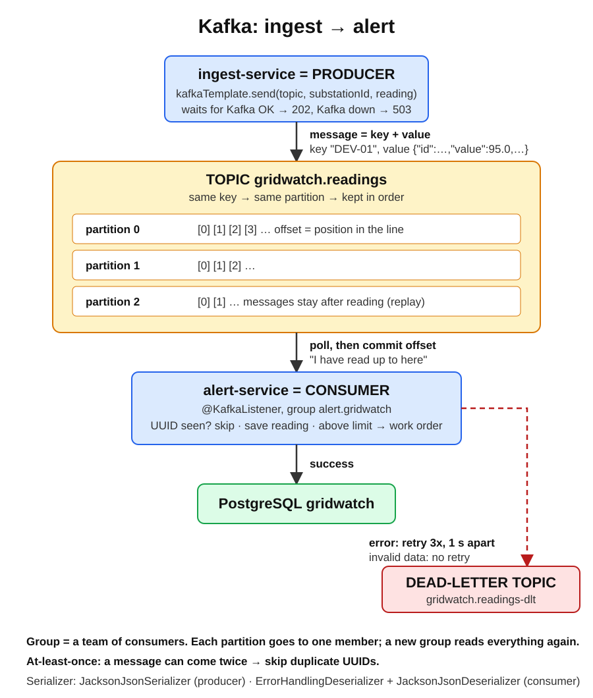

# Kafka basics

Plain-words introduction to Kafka as used in GridWatch. Exact settings and code: [kafka-cheatsheet.md](kafka-cheatsheet.md). Running it in Docker: [kafka-in-docker.md](kafka-in-docker.md).

## The problem it solves

When ingest-service called alert-service directly over HTTP, a reading was lost if alert-service was down or slow. Kafka sits in the middle and stores every event on disk. The sender drops the event off and moves on; the receiver picks it up when it is ready. Neither has to know if the other is running.

Think of it as a post office that keeps a copy of every letter, in order, for days.

## Words you need

| Word | Plain meaning | GridWatch example |
|---|---|---|
| Event / message / record | One thing that happened, as key + value | one sensor reading as JSON |
| Broker | A Kafka server | the `kafka` container |
| Topic | A named list of events, like a table name | `gridwatch.readings` |
| Partition | A topic is split into parallel lanes. Order is kept inside one lane | 3 partitions |
| Offset | The position number of an event inside a partition: 0, 1, 2... | — |
| Key | Decides the lane. Same key → same lane → kept in order | `substationId` |
| Producer | App that writes events | ingest-service |
| Consumer | App that reads events | alert-service |
| Consumer group | Consumers that share the work. Each group reads every event once | `alert.gridwatch` |
| Committed offset | Bookmark: "this group has processed up to here" | saved after each successful reading |
| Lag | How many events the group still has to read | 0 when everything is processed |
| Dead-letter topic (DLT) | Separate topic for events that keep failing, so they don't block the rest | `gridwatch.readings-dlt` |
| Retention | How long Kafka keeps events (default 7 days), even after they are read | — |

## How an event flows in GridWatch

1. Postman sends a reading to ingest-service.
2. ingest-service checks it, gives it a UUID and sends it to topic `gridwatch.readings` with key `DEV-01`.
3. Kafka picks the partition from the key, appends the event at the next offset and confirms. ingest answers `202`.
4. alert-service (group `alert.gridwatch`) reads the event, saves it, maybe opens a work order, then moves its bookmark forward.
5. If alert-service was down, the events wait in Kafka. On restart it continues from its bookmark. Nothing is lost.
6. If an event fails 3 times (or is clearly invalid), it goes to the DLT and the next event is processed.

## Kafka vs a normal queue (RabbitMQ)

| | Kafka | Classic queue |
|---|---|---|
| After reading | Event stays (until retention) | Message is removed |
| Re-read old events | Yes, move the offset back | No |
| Several independent readers | Yes, each group gets everything | Needs extra setup |
| Order | Per partition | Per queue |
| Good for | Event streams, history, many consumers | Tasks and jobs, routing |

## Rules worth remembering

- **At least once:** an event can arrive twice (after a crash or retry). The consumer must handle duplicates: GridWatch skips readings whose UUID it already stored.
- **Order only per partition:** use a key when order matters for that key.
- **More consumers than partitions = idle consumers:** 3 partitions → at most 3 active consumers in one group.
- **Kafka doesn't know your Java classes:** it stores bytes. Producer and consumer agree on the JSON shape, not on class names.

## Spring Boot in one look

- Producer: `KafkaTemplate.send(topic, key, value)`.
- Consumer: a method with `@KafkaListener(topics = ..., groupId = ...)`.
- Settings: `spring.kafka.*` in `application.yaml`.
- Topics: a `NewTopic` bean creates the topic at startup.

Full code and settings: [kafka-cheatsheet.md](kafka-cheatsheet.md).
