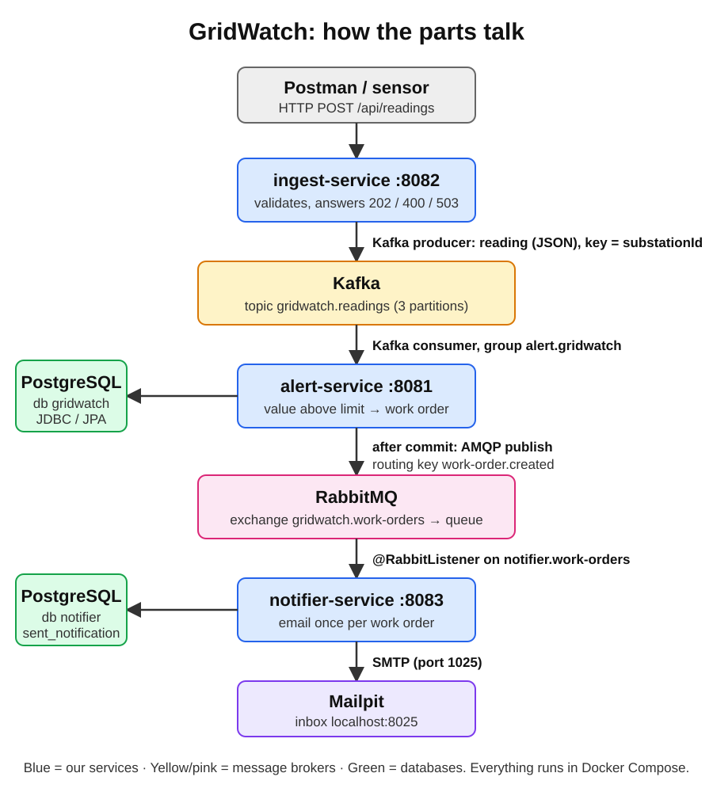
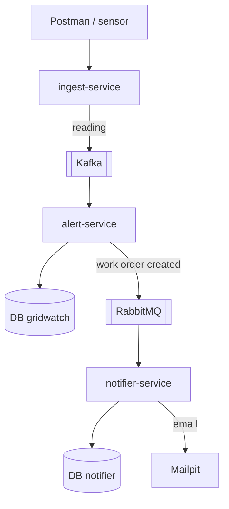
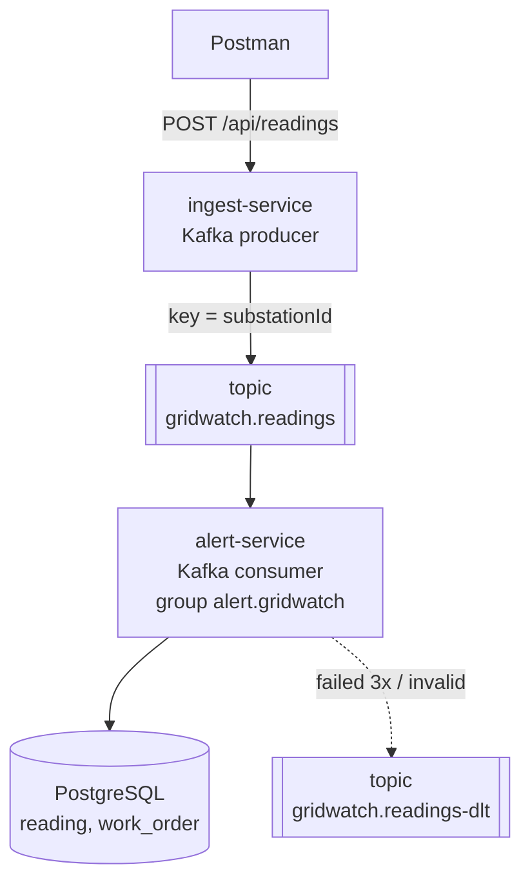
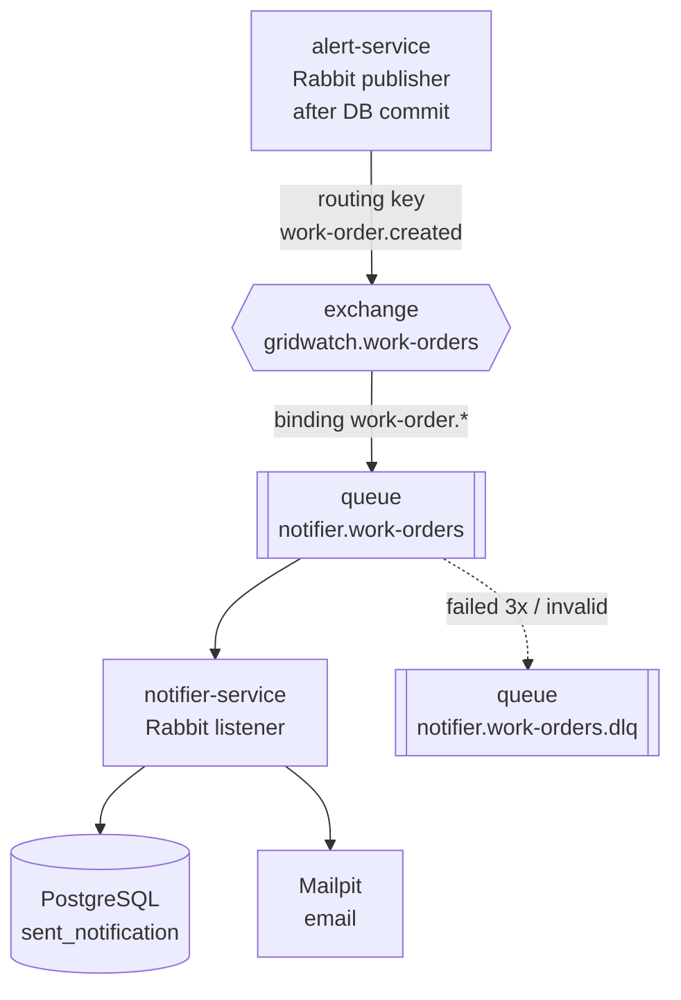
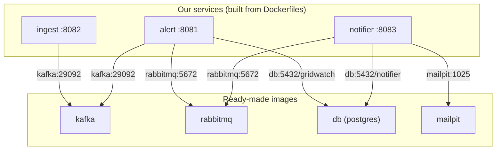

# Messaging flow: Kafka, RabbitMQ and Docker

How a reading travels from the REST call to a technician's email, what each piece does, and how it runs in Docker. Background: [kafka-basics.md](kafka-basics.md), [rabbitmq-basics.md](rabbitmq-basics.md), [docker-basics.md](docker-basics.md).

## Pictures

| Part | Image |
|---|---|
| Whole system | [01-overview.svg](images/01-overview.svg) |
| Kafka: ingest → alert | [02-kafka.svg](images/02-kafka.svg) |
| RabbitMQ: alert → notifier → email | [03-rabbitmq.svg](images/03-rabbitmq.svg) |
| Docker: containers and addresses | [04-docker.svg](images/04-docker.svg) |

## Overview

1. **ingest** checks the reading and puts it on **Kafka**.
2. **alert** reads it from Kafka, saves it, and opens a work order when a value is too high.
3. **alert** puts "work order created" on **RabbitMQ**.
4. **notifier** takes it from RabbitMQ and emails the technician once.

Kafka and RabbitMQ sit between the services, so each service keeps working when the next one is down: messages wait until it is back.

## 1. Kafka part: reading → work order

| Piece | What it does |
|---|---|
| **Producer** (ingest) | Sends the reading as JSON, waits for Kafka's OK → `202`, Kafka down → `503` |
| **Topic** `gridwatch.readings` | Stores readings in 3 partitions, keeps them after reading |
| **Key** `substationId` | Same substation → same partition → kept in order |
| **Consumer group** `alert.gridwatch` | alert-service reads all partitions, remembers its position (offset) |
| **Consumer** (alert) | Skips duplicate UUIDs, saves the reading, above the limit → work order |
| **Dead-letter topic** | After 3 retries (1 s apart), or at once for invalid data |

## 2. RabbitMQ part: work order → email

| Piece | What it does |
|---|---|
| **Publisher** (alert) | Sends `WorkOrderCreatedEvent` only after the work order is committed |
| **Exchange** (topic type) | Receives every message, routes it by routing key |
| **Routing key** `work-order.created` | Label on the message |
| **Binding** `work-order.*` | Rule: matching messages go to the notifier queue |
| **Queue** `notifier.work-orders` | Holds the job until the notifier acks it, then deletes it |
| **Listener** (notifier) | Validates, skips work orders already emailed, saves the id and sends the email in one transaction |
| **Retry** | 3 attempts (1 s, 2 s); invalid data is not retried |
| **Dead-letter queue** | Where failed messages wait for a human |

## 3. Kafka vs RabbitMQ words

| | Kafka | RabbitMQ |
|---|---|---|
| Sender | Producer | Publisher |
| First stop | Topic | Exchange |
| Routing | Key → partition | Routing key + binding |
| Waits in | Partition (kept for days) | Queue (deleted after ack) |
| Receiver | Consumer in a group | Listener |
| Done signal | Offset commit | Ack |
| Gives up | Dead-letter topic | Dead-letter queue |
| Duplicates | Reading UUID already saved → skip | Work order id already in `sent_notification` → skip |
| Used for | Stream of readings (facts) | Notifications (jobs, done once) |

## 4. Docker: containers and addresses

| Service | Image | Port on laptop | Data kept in | Starts after |
|---|---|---|---|---|
| db | `postgres:17-alpine` | 5435 | volume `postgres-data` | — |
| kafka | `apache/kafka:4.1.0` | 9092 | volume `kafka` | — |
| rabbitmq | `rabbitmq:4-management-alpine` | 5672, dashboard 15672 | volume `rabbitmq` | — |
| mailpit | `axllent/mailpit:v1.27` | 1025, inbox 8025 | — | — |
| ingest | built from `./ingest-service` | 8082 | — | kafka healthy |
| alert | built from `./alert-service` | 8081 | — | db, kafka, rabbitmq healthy |
| notifier | built from `./notifier-service` | 8083 | — | db, rabbitmq healthy, mailpit |

**Address rule:** inside Docker, use the service name (`kafka:29092`, `db:5432`). From the laptop or IntelliJ, use `localhost` (`localhost:9092`, `localhost:5435`). Compose sets this with environment variables such as `SPRING_KAFKA_BOOTSTRAP_SERVERS`, `SPRING_RABBITMQ_HOST`, `SPRING_DATASOURCE_URL`, `SPRING_MAIL_HOST`.

**Our images:** two-stage Dockerfile (JDK builds the jar, small JRE runs it), about 150 MB each.

## 5. Where it is configured

| What | File |
|---|---|
| Brokers, database, ports, volumes, addresses | `docker-compose.yml` |
| Producer settings, topic name | `ingest-service/.../application.yaml`, `kafka/Topics` |
| Consumer, retries, DLT | `alert-service/.../application.yaml`, `kafka/KafkaErrorHandler` |
| Exchange, publish after commit | `alert-service/.../rabbit/RabbitConfig`, `rabbit/WorkOrderPublisher` |
| Queue, binding, DLQ, retries | `notifier-service/.../application.yml`, `rabbit/RabbitConfig` |
| Send once, email | `notifier-service/.../service/NotificationService`, `mail/EmailService` |

Exact settings, code and commands: [kafka-cheatsheet.md](kafka-cheatsheet.md), [rabbitmq-cheatsheet.md](rabbitmq-cheatsheet.md), [kafka-in-docker.md](kafka-in-docker.md).

## 6. When something is wrong

| Symptom | Look at |
|---|---|
| ingest returns 503 | `docker compose ps`: is kafka healthy? |
| Reading not saved | consumer lag, alert log, `gridwatch.readings-dlt` |
| Work order saved, no email | alert log "Published", dashboard bindings, queue Ready/Unacked, notifier log |
| Message in the DLQ | dashboard → Get messages → `x-death` header |
| Two emails | `sent_notification` table in database `notifier` |
