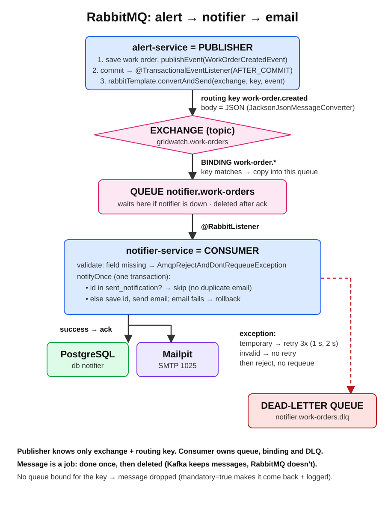

# RabbitMQ basics

Plain-words introduction to RabbitMQ as used in GridWatch. Compare with [kafka-basics.md](kafka-basics.md). Settings, code and commands: [rabbitmq-cheatsheet.md](rabbitmq-cheatsheet.md).

## The problem it solves

When alert-service creates a work order, a technician must be notified. That is a **job**: do it once, retry if it fails, park it if it keeps failing. alert-service should not wait for an email server, and a notification must not be lost if the notifier is down. RabbitMQ holds the job until a worker has done it, then removes it.

## Words you need

| Word | Plain meaning | GridWatch |
|---|---|---|
| Broker | The RabbitMQ server | `rabbitmq` container |
| Producer | App that sends messages | alert-service |
| Consumer | App that takes messages from a queue | notifier-service |
| Exchange | The post office sorting desk. Producers always send to an exchange, never straight to a queue | `gridwatch.work-orders` |
| Queue | A mailbox where messages wait until a consumer takes them | `notifier.work-orders` |
| Binding | A rule "exchange → queue when the routing key matches" | `work-order.*` → `notifier.work-orders` |
| Routing key | Label on the message the exchange sorts by | `work-order.created` |
| Ack | Consumer says "done, delete it" | sent by Spring after the listener succeeds |
| Nack / reject | Consumer says "failed" → retry or dead-letter | thrown exception |
| Dead-letter queue (DLQ) | Mailbox for messages that keep failing | `notifier.work-orders.dlq` |
| Durable | Exchange/queue survives a broker restart | all of ours |
| Persistent message | Message is written to disk | default in Spring |

## Exchange types

| Type | Routes by | Use |
|---|---|---|
| direct | routing key equals binding key | one job type → one queue |
| topic | pattern: `*` = one word, `#` = zero or more words | `work-order.*` matches `work-order.created`, `work-order.closed` |
| fanout | ignores the key, copies to every bound queue | broadcast |
| headers | message headers | rare |

GridWatch uses a **topic** exchange, so later events (`work-order.closed`) or other queues (an SMS service) can be added without changing alert-service.

## How a message flows

1. alert-service saves a work order and publishes `{"workOrderId":42,...}` to exchange `gridwatch.work-orders` with key `work-order.created`.
2. The exchange checks its bindings and puts a copy in `notifier.work-orders`.
3. notifier-service takes it, sends the email, and acks. The message is deleted.
4. If the notifier throws, Spring retries a few times. Still failing → rejected → RabbitMQ moves it to the DLQ.
5. If the notifier is down, messages wait in the queue.

## Kafka vs RabbitMQ

| | Kafka | RabbitMQ |
|---|---|---|
| Model | Log of events, kept for days | Queue of jobs, removed after ack |
| Read again later | Yes (move the offset) | No |
| Many independent readers | Each group reads everything | One queue per reader, filled by the exchange |
| Routing | By topic and key only | Exchanges, bindings, patterns |
| Order | Per partition | Per queue (with one consumer) |
| Failed message | Error handler + DLT topic | Reject → dead-letter exchange → DLQ |
| GridWatch | Sensor readings (stream, replay, more consumers later) | Technician notifications (do once, retry, park) |

## Rules worth remembering

- **At least once** here too: a message can arrive twice (crash before the ack). The notifier must not send two emails for the same work order.
- Producers know only the **exchange and routing key**, never the queue. The consumer side owns its queue and binding.
- A message nobody's queue is bound for is **dropped silently**. Declare the queue and binding before sending, or check the dashboard.
- One consumer per queue keeps order. Several consumers on one queue share the work (competing consumers).

## Dashboard (http://localhost:15672)

| Tab | Look at |
|---|---|
| Exchanges | `gridwatch.work-orders` → Bindings |
| Queues | Ready (waiting), Unacked (being processed), Total; Get messages to peek |
| Connections / Channels | Is the app connected |
