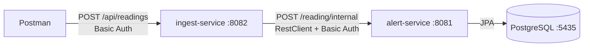

# Week 1: Two REST services and the alert rule

## Goal

Receive sensor readings, store them, and open a maintenance work order when a value is above its limit. Two Spring Boot services talking over HTTP, PostgreSQL in Docker, protected with Basic Auth.

## What was built

*(In week 2 the HTTP call between the services was replaced by Kafka.)*

### ingest-service
- `POST /api/readings`: validates the input (Bean Validation), creates a **UUID** for the reading, forwards it to alert-service.
- Answers `202 Accepted` with `{ "id": ... }`, `400` for invalid input, `503` when alert-service is unreachable.
- `RestClient` built once, with alert-service's URL and credentials from configuration.

### alert-service
- `POST /reading/internal`: receives a reading.
- `GET /work-orders`: lists work orders as response records (entities are never returned directly).
- Rule: `TEMPERATURE` above 90 or `LOAD` above 100 → work order with status `OPEN` and a reason such as `TEMPERATURE 120.0 above limit 90`. The limits live in the `SensorTypeOption` enum.
- Duplicate check: a reading whose id already exists is skipped.
- `@Transactional`: the reading and the work order are saved together or not at all.

### Data model

| Table | Key columns |
|---|---|
| `reading` | `id` UUID (assigned by ingest), `substation_id`, `sensor_type` (text), `value`, `measured_at` (timestamptz), `created_at`, `updated_at` |
| `work_order` | `id` bigint identity, `substation_id`, `reason`, `work_order_status` (text), `created_at`, `updated_at` |

All columns are `NOT NULL`. Hibernate creates the tables (`ddl-auto: update`); Flyway takes over later.

### Security
- HTTP Basic, CSRF disabled, stateless sessions, `/actuator/health` open.
- Fixed users from `application.yaml` (`spring.security.user.*`).

## Design decisions

| Decision | Reason |
|---|---|
| UUID for readings, created by ingest | Enables duplicate detection (needed with Kafka) |
| `Long` for work orders | Internal, easy to refer to |
| `Instant` + timestamptz | No daylight-saving or time-zone bugs |
| Enums as text, limits in the enum | Safe when values are added; one place to change limits |
| ingest-service has no database | Each service owns its data |
| DTOs instead of entities in the API | Don't leak internals or couple the API to the database |
| Basic Auth, CSRF off, stateless | Service API with credentials on every request |

## How to verify

1. `POST :8082/api/readings` with `{"substationId":"DEV-01","sensorType":"TEMPERATURE","value":95.5,"measuredAt":"2026-10-16T09:30:00Z"}` → `202`, a reading and a work order.
2. Value 60 → reading saved, no work order.
3. Missing `substationId` → `400`. No login → `401`.
4. Same id twice → stored once.

## Problems solved along the way

| Problem | Cause | Fix |
|---|---|---|
| Both services on port 8080 | `spring.servers.port` | `server.port` at top level |
| Columns nullable after adding `nullable = false` | `ddl-auto: update` never changes existing columns | Recreate the schema (`docker compose down -v`); Flyway later |
| Timestamps empty | `@CreationTimestamp` on getters while `@Id` is on a field | Put all annotations on fields |
| GET works, POST `401` | CSRF protection, error forwarded to `/error` | Custom `SecurityFilterChain` with CSRF off |
| No login possible after custom security | Own `SecurityFilterChain` disables Boot's defaults | Add `httpBasic` explicitly |
| `Could not autowire RestClient.Builder` | Spring Boot 4 moved it to a separate module | `spring-boot-starter-restclient` |
| IntelliJ "JVM target 5" | Module not imported as Maven project | Add `pom.xml` as Maven project, reload |

## Commits

`feat: set up ingest and alert services with PostgreSQL` → `feat: add reading and work order entities and repositories` → `feat: receive readings, apply limits and create work orders` → `feat: forward readings from ingest-service to alert-service`
