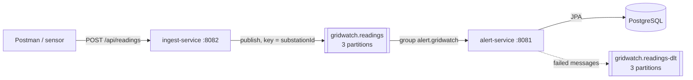

# Week 2: Kafka between the services

## Goal

Replace the synchronous HTTP call between ingest-service and alert-service with Kafka, so readings are not lost when alert-service is down, and handle messages that can't be processed.

## What was built



### Infrastructure
- Kafka 4.1 (KRaft, single broker) in `docker-compose.yml`, with a health check and a data volume.
- Two listeners: `localhost:9092` for apps on the laptop, `kafka:29092` for containers.

### ingest-service (producer)
- Creates topic `gridwatch.readings` (3 partitions) at startup.
- Validates the sensor type (`SensorTypeOption.valueOf`) → `400` if unknown. ingest knows only the valid names; the limits stay in alert-service.
- Publishes the reading as JSON with key = `substationId`, and **waits for Kafka's confirmation** (5 s): `202` only after Kafka stored it, `503` if Kafka is unreachable.
- Producer: `acks=all`, idempotence on, short timeouts, no type headers.
- The RestClient call to alert-service was removed.

### alert-service (consumer)
- `@KafkaListener` on `gridwatch.readings`, group `alert.gridwatch`, calls the existing `ReadingService` (duplicate check, limit rule, work order).
- `ErrorHandlingDeserializer` + JSON deserializer with a fixed target type and no type headers.
- Offsets are committed by Spring after the listener succeeds.
- **Error handling:** `DefaultErrorHandler` with `FixedBackOff(1000 ms, 3 retries)`; `InvalidReadingException` is not retried. Failed messages go to `gridwatch.readings-dlt` with headers describing the error.
- DLT producer uses `DelegatingByTypeSerializer`: raw bytes for messages that couldn't be deserialized, JSON for objects that failed in processing.

### Event contract

Topic `gridwatch.readings`, key = `substationId`:

```json
{
  "id": "0b5a3c2e-1d4f-4a6b-9c8d-111111111111",
  "substationId": "DEV-01",
  "sensorType": "TEMPERATURE",
  "value": 95.5,
  "measuredAt": "2026-10-16T09:30:00Z"
}
```

| Field | Type | Required | Notes |
|---|---|---|---|
| `id` | UUID | yes | Created by ingest-service; used for duplicate detection |
| `substationId` | string | yes | Also the message key |
| `sensorType` | string | yes | `TEMPERATURE` or `LOAD` |
| `value` | number | yes | |
| `measuredAt` | ISO-8601 instant (UTC) | yes | |

## Verified behaviour

| Test | Result |
|---|---|
| Reading via ingest | In the topic with the right key and partition, consumed (lag 0), saved, work order above the limit |
| **Resilience:** alert-service stopped, 3 readings sent | ingest still answered `202`; lag rose to 3; after starting alert-service all 3 were processed and lag returned to 0 |
| Broken message (`hello`) produced by hand | Moved to the DLT with `DeserializationException` headers, not retried forever |
| Unknown sensor type produced by hand | Moved to the DLT immediately with `InvalidReadingException` |
| Good reading behind a bad one | Processed once the bad one reached the DLT |
| Unknown sensor type via ingest | `400` before publishing |
| **Full stack in Docker:** alert container stopped, 2 readings sent | Both `202`; saved about 30 s after `docker compose start alert`, lag 0 |

How to check each step: see [kafka-cheatsheet.md](../kafka-cheatsheet.md).

## Design decisions

| Decision | Reason |
|---|---|
| Kafka instead of HTTP | Readings survive alert-service downtime; ingest isn't slowed by alert; new consumers need no change to ingest |
| Key = substationId | Order per substation; different substations in parallel |
| Wait for the send result before `202` | `202` means "stored in Kafka", so the client knows when to retry |
| No outbox in ingest | ingest has no database, so there is no dual write |
| Validate in ingest, DLT in alert | Reject bad input early; the DLT is the safety net for what still fails |
| No type headers | Services share the JSON shape, not Java classes |
| DLT with the same partition count | The recoverer publishes to the same partition number by default |

## Problems solved along the way

| Problem | Cause | Fix |
|---|---|---|
| Kafka always unhealthy | Missing space in the health check command | `--bootstrap-server localhost:9092` |
| Topic or consumer group missing | Services started before Kafka was recreated | Start Docker first, then the services |
| `@Value` topic name was null | `@Value` on a static field | Constructor / `@Bean` parameter |
| "class ... not in the trusted packages" | Producer sent `__TypeId__` with its own class name | Type headers off on both sides |
| Message consumed but not saved | Default handler skips after retries | Error handler + DLT |
| DLT empty, partition blocked | DLT publish failed (serializer configured twice) → record never recovered | One configuration source for the serializer |
| DLT had 1 partition | Auto-created before the `NewTopic` bean | Delete it and let the bean create it |

## Running everything in Docker

- Multi-stage `Dockerfile` per service (JDK 21 build stage, JRE 21 run stage, ~120-150 MB images) and a `.dockerignore`.
- `alert` and `ingest` added to `docker-compose.yml` with `build:`, ports, environment overrides (`db:5432`, `kafka:29092`) and `depends_on: condition: service_healthy`.
- One command starts the whole system: `docker compose up -d --build`. Details: [kafka-in-docker.md](../kafka-in-docker.md).
- alert-service's old `POST /reading/internal` was removed: Kafka is the only way readings enter alert-service.

| Problem | Cause | Fix |
|---|---|---|
| `bind: ... 8082 ... only one usage` | Same services still running in IntelliJ | Stop them; never run a service in both places |
| Typo `--form=build` | — | `--from=build` |
| `-db:` under `depends_on` | List syntax mixed into a map | `db:` with `condition:` below |
