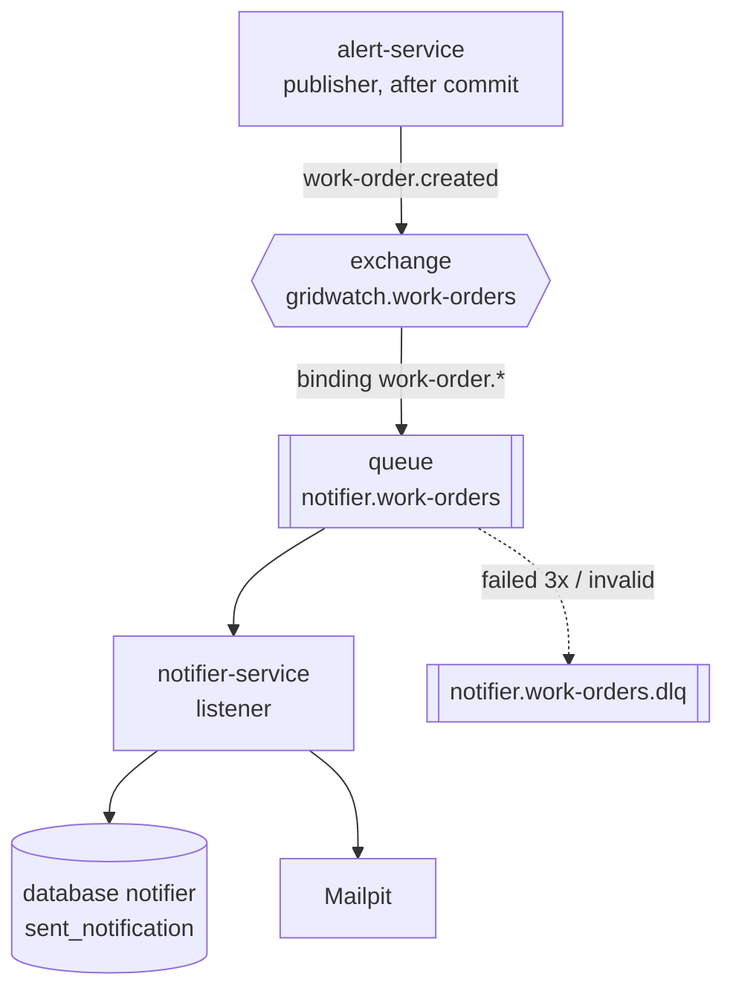
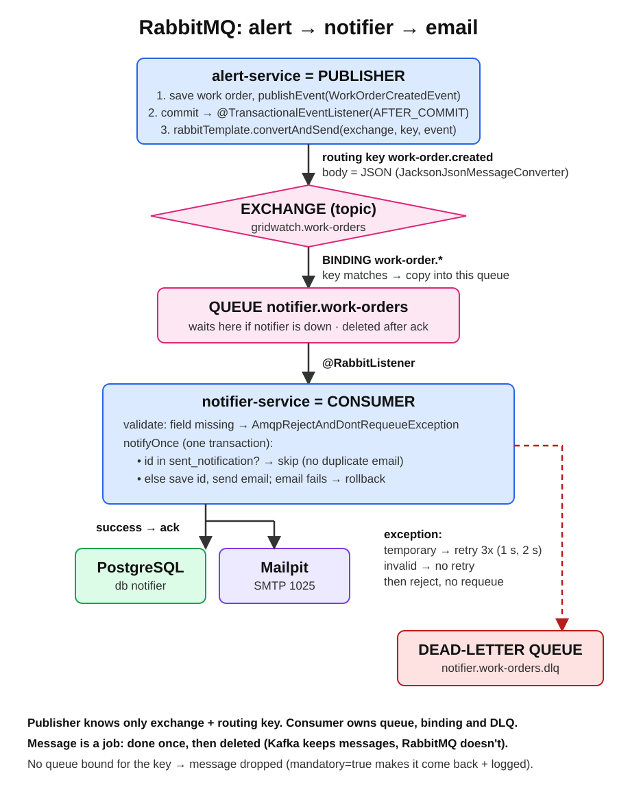

# Week 3: notifier-service with RabbitMQ

## Goal

When alert-service opens a work order, the technician team gets an email. A new notifier-service does this through RabbitMQ, without losing or duplicating notifications, and keeps working when the mail server or the notifier itself is down.

## What was built



### Infrastructure
- RabbitMQ 4 (management image) in Docker Compose: own user, volume, healthcheck, dashboard on 15672.
- Mailpit: test SMTP server on 1025, inbox on 8025. No email leaves the laptop.
- Database `notifier` in the existing PostgreSQL container.

### alert-service (publisher)
- `spring-boot-starter-amqp`, topic exchange `gridwatch.work-orders`, JSON message converter.
- After saving a work order, `ReadingService` publishes an in-app `WorkOrderEvent`.
- `WorkOrderPublisher` (`@TransactionalEventListener(AFTER_COMMIT)`) sends it to RabbitMQ only when the database transaction committed.
- alert knows only the exchange and routing key, not the queue.

### notifier-service (new, port 8083)
- Declares its own queue `notifier.work-orders`, binding `work-order.*` and dead-letter queue `notifier.work-orders.dlq`.
- `WorkOrderListener` validates the message; a missing field is rejected straight to the DLQ.
- `NotificationService.notifyOnce` (one transaction): work order id already in `sent_notification` → skip; otherwise save the id, then send the email. A failed email rolls back the save, so the retry can try again.
- `EmailService` sends a `SimpleMailMessage` through `JavaMailSender`.
- Retries: 3 attempts (1 s, 2 s), then no requeue → DLQ. A `RabbitListenerRetrySettingsCustomizer` skips retries for `AmqpRejectAndDontRequeueException`.

### Docker
- Dockerfile and `.dockerignore` for notifier (same two-stage build as the other services).
- Compose: `notifier` service; alert and notifier use `SPRING_RABBITMQ_HOST: rabbitmq`, notifier uses `SPRING_MAIL_HOST: mailpit` and `db:5432/notifier`; `depends_on` with healthchecks.

### Message contract

Exchange `gridwatch.work-orders`, routing key `work-order.created`:

```json
{
  "workOrderId": 22,
  "substationId": "DEV-01",
  "reason": "LOAD 130.0 above limit 100",
  "createdAt": "2026-10-18T19:10:01.123Z"
}
```

## Verified behaviour

| Test | Result |
|---|---|
| Reading above the limit | Work order saved, message published after commit, email in Mailpit |
| Reading below the limit | No message |
| Routing check | A debug queue bound with `#` received the message; wrong routing key → dropped |
| Mail server down | 3 attempts in about 3 s, then DLQ; no row in `sent_notification` (rollback worked) |
| Invalid message (missing fields) | In the DLQ within the same second, no retries |
| Same work order published twice | One email; second logged as "Already notified" |
| **Resilience (all in Docker):** notifier stopped, 2 readings sent | Queue Ready = 2; after `docker compose start notifier` both emails arrived, queue back to 0 |

## Design decisions

| Decision | Reason | Alternative |
|---|---|---|
| RabbitMQ for notifications, Kafka for readings | A notification is a job done once (ack, retry, park); readings are a stream of facts (keep, replay, many readers) | Kafka for both: no per-message retry/DLQ routing built in |
| Topic exchange + routing key | Publisher doesn't know consumers; an SMS service can bind its own queue later | Direct publish to a queue: couples alert to notifier |
| Publish after commit | No notification for a work order that was rolled back | Publish inside the transaction; transactional outbox (later, if lost notifications on crash matter) |
| Consumer owns queue, binding, DLQ | Clear ownership, publisher stays unaware | Declare everything in alert |
| Limited retries + DLQ | Temporary failures recover; permanent ones don't block or loop | Default requeue: endless loop |
| No retry for invalid data | Waiting never fixes bad data | Retry everything |
| `sent_notification` with work order id as primary key, save + send in one transaction | At-least-once delivery + idempotent consumer = one email; failed email retried | Send first (duplicates on crash) or save first without transaction (lost emails) |
| Own database `notifier` | Each service owns its data | Tables in alert's database |
| Mailpit | Real SMTP, visible result, nothing sent outside | Mocked mail sender |

Remaining gap, accepted: if the app crashes after the email is sent but before the commit, the retry sends a second email. Email and the database can't share one transaction.

## Problems solved along the way

| Problem | Cause | Fix |
|---|---|---|
| Exchange name `null` | `@Value` on static fields | Constructor / `@Bean` parameters |
| Message sent before commit | Publisher method called directly, so `@TransactionalEventListener` ignored | `ApplicationEventPublisher.publishEvent` |
| alert consumed its own messages | Queue, binding and listener declared in alert | Moved to notifier |
| Same message retried every few ms | Default requeue on failure | Retry limit, `default-requeue-rejected: false`, DLQ |
| Notifier didn't connect, no queues | Password cut off in yaml | Correct password |
| Failed messages vanished | Dead-letter routing key was placeholder text | One `rabbit.dlq` property for queue argument and DLQ name |
| `PRECONDITION_FAILED inequivalent arg` | Queue existed without DLQ settings | Delete the queue, let the app recreate it |
| Invalid message retried 3 times | `AmqpRejectAndDontRequeueException` wrapped and retried | Retry predicate that checks the cause |
| Duplicate still emailed | No `return` after the "already notified" check | Return early |
| alert container not started | Same service still running in IntelliJ on 8081 | Stop IntelliJ services before `docker compose up` |

## Commits

`feat: publish work order created events to rabbitmq` → `feat: add notifier-service with rabbitmq and email` → `feat: send only one notification per work order` → `docs: add messaging flow diagrams and rabbitmq cheat sheet` → `feat: run notifier, rabbitmq and mailpit in docker compose`



More: [messaging-flow.md](../messaging-flow.md), [rabbitmq-basics.md](../rabbitmq-basics.md), [rabbitmq-cheatsheet.md](../rabbitmq-cheatsheet.md).
